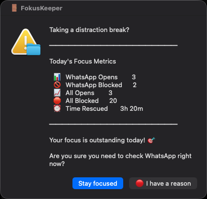

# FokusKeeper

A macOS distraction gate. Opening Slack, YouTube, or eight other time sinks costs you one deliberate click first.



## What it does

FokusKeeper watches your frontmost app. When you open a gated app or switch a browser tab to a gated site, it blocks the surface (quits the app, or parks the tab at `about:blank`) and shows a dialog with today's numbers: opens, blocks, time rescued, and a motivation line.

Two buttons:

- **Stay focused** (default): the app stays quit or the tab closes, and your prevented-distraction count goes up.
- **I have a reason**: the app relaunches or the tab restores to its exact URL, and you get a cooldown (3 minutes by default, adjustable) with no further prompts.

That is the whole product. It is a speed bump, not a wall. Most distraction checks are reflexes; making the reflex cost one conscious decision is enough to kill a large share of them, and the dialog shows you the running score.

## Download

[**Download the latest FokusKeeper DMG**](https://github.com/cipshadow/fokuskeeper/releases/latest)

Open `FokusKeeper.dmg`, then drag **FokusKeeper.app** to the Applications shortcut. Open the app from Applications. It runs as a menu-bar app, so it does not appear in the Dock.

FokusKeeper is unsigned by design. On its first launch, Control-click **FokusKeeper.app**, choose **Open**, then choose **Open** in the confirmation dialog. macOS remembers that choice for this installed build. If macOS does not show that option, attempt to open it once, then use **System Settings -> Privacy & Security -> Open Anyway**.

Each release includes a `FokusKeeper.dmg.sha256` file. Verify it from Terminal with `shasum -a 256 FokusKeeper.dmg` before opening the DMG if you want to confirm the download.

## Apps

| App or site | Native app | Web (Chrome, Safari) |
|---|---|---|
| Slack | Slack | app.slack.com |
| Gmail | - | mail.google.com |
| WhatsApp | WhatsApp | web.whatsapp.com |
| Instagram | - | instagram.com |
| Facebook | - | facebook.com |
| Reddit | - | reddit.com |
| YouTube | - | youtube.com |
| X | - | x.com, twitter.com |
| TikTok | - | tiktok.com |
| LinkedIn | - | linkedin.com |

You pick which of these to gate at first run; all ten are pre-selected. Firefox isn't supported — it has no AppleScript support for reading tab URLs, so there's no reliable way to gate it (see the FAQ).

## How it works

The bundled FokusKeeper daemon polls the frontmost application every 0.5 seconds via `osascript`. When Chrome or Safari is frontmost it also reads the active tab's URL. Detection is edge-triggered: an app prompts when you switch to it, not continuously while you stay on it.

On each detected open, the gate decides in strict precedence order:

1. **Cooldown**: within the cooldown window (default 3 minutes) of a grant, allow silently.
2. **First open of the day**: auto-allow (you get one free check).
3. **Quiet period**: no use of that app in the quiet-period window (default 60 minutes), auto-allow.
4. **Prompt**: block the surface and show the dialog.

Cooldowns are shared per app across surfaces: allowing the Slack app also covers app.slack.com in your browser for the same window. The cooldown clock is fixed at the moment of the grant; continued use does not extend it. Both windows are adjustable -- see **Customization** below.

## Prerequisites

- macOS 13 or later, on an Intel or Apple Silicon Mac
- Google Chrome and/or Safari, if you want web gating (the app surfaces work without either)

## Install

Download the latest DMG from [Releases](https://github.com/cipshadow/fokuskeeper/releases), drag the app to Applications, then launch it. No terminal, source checkout, Python, Homebrew, or network access after download is required.

At the first launch, the menu-bar icon starts FokusKeeper and the daemon. Add **FokusKeeper** in **System Settings -> General -> Login Items** if you want it to start when you sign in.

Developers who want to work from source can use the scripts in this repository. That workflow is separate from the supported release install path.

On first run a short welcome screen explains how the dialog and cooldown work, then a native chooser lists all ten apps, pre-selected (deselect any you want ungated), followed by the Settings window for cooldown and quiet-period minutes. Your choices are saved to `~/.fokuskeeper-config.json`. Change any of it again any time from the menu bar icon's **Settings...** menu item.

### Permissions

macOS asks for **Automation** permission the first time FokusKeeper talks to System Events (frontmost-app polling), Google Chrome, and Safari (tab reading) -- each browser is a separate grant, only asked for the ones you actually use. Click Allow.

Grants are tied to the installed FokusKeeper app. If browser gating does not work, check **System Settings -> Privacy & Security -> Automation** and allow FokusKeeper to control the affected browser.

## Developer CLI

The released app is controlled from its menu-bar icon. The following commands are for a source checkout only:

```bash
./fokuskeeper start      # start the daemon
./fokuskeeper stop       # stop it
./fokuskeeper restart    # stop + start
./fokuskeeper status     # daemon liveness plus today's stats
./fokuskeeper logs       # last 20 log lines
./fokuskeeper stats      # today's per-app numbers
./fokuskeeper history    # last 7 days, grouped by date
./fokuskeeper report     # all-time totals
./fokuskeeper timesaved  # modeled time saved: last 7 days and all time
./fokuskeeper reset      # zero today's counters (cooldowns survive)
./fokuskeeper settings   # choose apps, adjust cooldown / quiet-period minutes
```

Sample `stats` output:

```
FokusKeeper - Today's stats (2026-08-30)
  Slack: opens 3, blocked 2, cooldown none
  Gmail: opens 1, blocked 0, cooldown 2m left
  ...
  Total opens: 4
  Total blocked: 2
```

## Time saved

`./fokuskeeper timesaved` and the dialog's "Time Rescued" line use the same model, and every Friday at 16:00 the daemon posts a macOS notification with that week's figure. It is a model under stated assumptions, not measured time:

- each **blocked** distraction ("Stay focused") is credited 10 minutes;
- each **reasoned** open ("I have a reason") is debited 1 minute for the dialog;
- **auto-allowed** opens (first of the day, quiet period) count for nothing either way, since no dialog was shown and no decision was made;
- net minutes = blocks × 10 − reasoned × 1. At that ratio the number tracks your block count almost one-to-one, which is why the output always prints the counts next to it.

Deterrence isn't recorded (opens that never happened because the gate exists leave no trace), so treat it as a lower bound of the model, not a measurement. All three multipliers are overridable in `~/.fokuskeeper-config.json`:

```json
{ "minutes_saved_per_block": 10, "minutes_cost_per_reasoned_open": 1, "workday_hours": 8 }
```

Each open the daemon records now carries the reason it was allowed (`auto_first_of_day`, `auto_quiet_period`, `reasoned`). Opens recorded before this version have no reason and are reconstructed from timing using your current quiet-period setting, so old events near that boundary can be misclassified.

The Friday notification fires from the daemon on its first check at or after 16:00, so a Mac that was asleep at 16:00 gets it on wake, and it is sent once per week even across restarts. If the daemon isn't running at all that week, nothing is sent. The banner comes from `osascript`, so macOS may attribute it to **Script Editor** in System Settings → Notifications; allow it there if nothing appears.

## Customization

- **Apps and timing**: click **Settings...** in the menu bar icon's menu, or run `./fokuskeeper settings` from a terminal -- both open one window with the app checklist and both timing fields (cooldown and quiet-period minutes, 1-1440 each) together, pre-filled with your current values. Save writes everything at once; Cancel leaves your existing settings untouched. Changes apply live; the daemon watches the config file's mtime, no restart needed. (A headless install without the menu bar's `rumps`/AppKit dependency falls back to three separate native dialogs instead -- same settings, same result.)
- **Menu bar icon**: a shield-with-K icon shows daemon state. Click it to start or stop FokusKeeper. If it is not visible, check the hidden-items area of any menu-bar organizer you use.

## Uninstall

Quit FokusKeeper from its menu-bar menu, remove **FokusKeeper.app** from Applications, and remove it from Login Items if you added it there. To also remove its local settings and history, delete `~/.fokuskeeper-state.json`, `~/.fokuskeeper-history.json`, and `~/.fokuskeeper-config.json`.

The source-tree `uninstall.sh --purge` remains available for developers and removes legacy files too.

## Releases

Pushing a `v*` tag builds and publishes an unsigned universal DMG. Pull requests run the same build without publishing it. The build uses universal2 Python, checks every bundled Mach-O file for both `x86_64` and `arm64`, and sets the app's minimum supported macOS version to 13.0.

## FAQ

**Which browsers are gated?**
Google Chrome and Safari. Arc is Chromium-based but untested; Firefox can't be supported the same way -- it has no AppleScript dictionary support for reading a tab's URL, so there's no reliable way to detect what site is open. Native app gating (Slack, WhatsApp) works regardless of browser.

**Does restoring an allowed tab work the same way in both browsers?**
Almost. Chrome exposes a stable numeric id per tab, so a restore always lands on the exact tab even if you've opened others in that window meanwhile. Safari's scripting support has no per-tab id -- only a window id -- so FokusKeeper restores to "whatever tab is current in that window" instead. In practice this only differs if you switch to a different tab in that same window during the second or so the dialog takes to appear.

**Why only app.slack.com and not all of slack.com?**
Matching all of slack.com would also gate sign-in and marketing pages, and the sign-in flow would get you prompted twice on the way into the app. The hostname match is deliberate.

**I opened two distractions at once and only got one dialog.**
While a dialog is up the poll loop is paused, so a second app opened meanwhile is missed. It gets caught on its next focus change.

**Where does my data go?**
Nowhere. State, history, and config live in your home directory (`~/.fokuskeeper-state.json`, `~/.fokuskeeper-history.json`, `~/.fokuskeeper-config.json`), the log in `~/Library/Logs/fokuskeeper.log`, all with `chmod 600`. No telemetry, no network calls.

**Can I bypass it?**
Yes, trivially: stop the daemon, or click the allow button. FokusKeeper is a mindfulness speed bump for yourself, not parental controls. If you can bypass it without noticing you did, that is the moment it was built for.

**What does 0.5-second polling cost?**
One short `osascript` call per tick (two while a supported browser is frontmost). CPU use is negligible on any modern Mac.

**What happens if I press Return while the dialog is focused?**
"Stay focused" is the default button, so Return blocks. Reflex-smashing the keyboard lands on the safe side; allowing requires clicking the other button.

**I upgraded from the old version. Where are my stats?**
Legacy `~/.slack-gatekeeper-*.json` files are copied to the new names automatically on first run; the originals stay in place as rollback.

**I can't find the menu bar icon.**
The daemon and gating still work either way -- the icon is a convenience, not a dependency. If you run a menu bar organizer (Bartender, Ice, and similar), check its hidden/overflow section first; some are configured to auto-hide inactive icons. Either way, `./fokuskeeper start|stop|status` from a terminal always works regardless of icon visibility.

## License

MIT. See [LICENSE](LICENSE).
